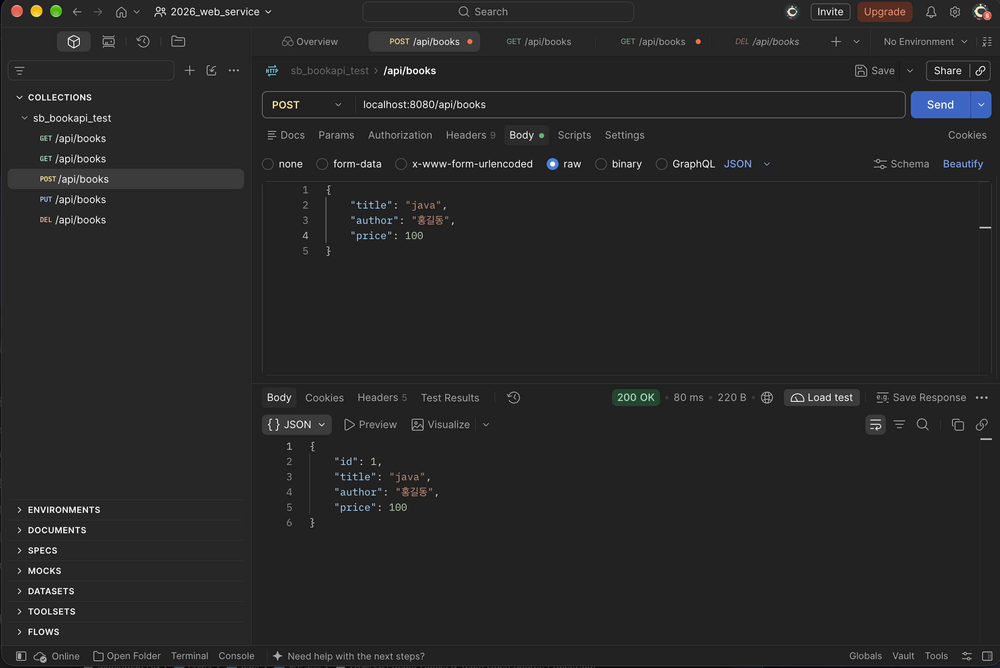
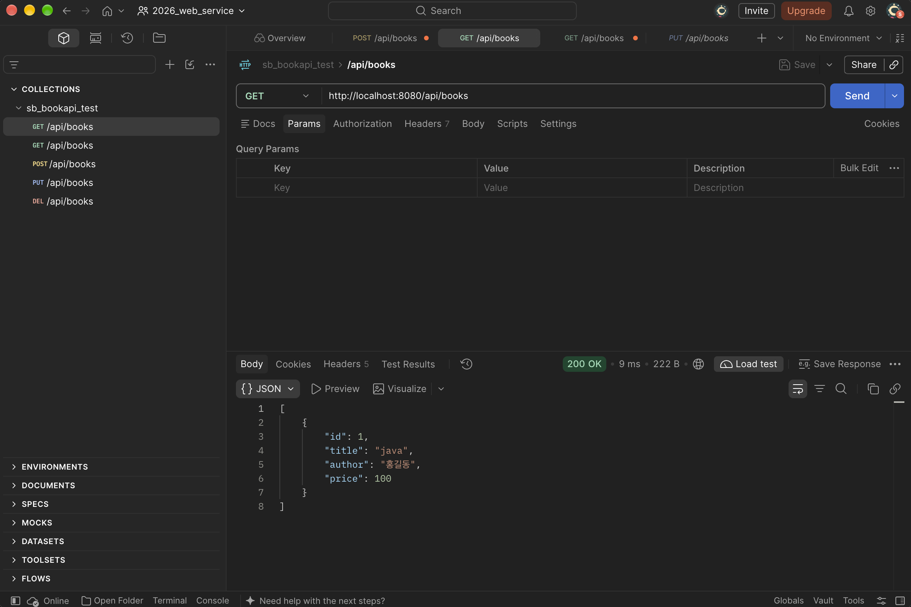
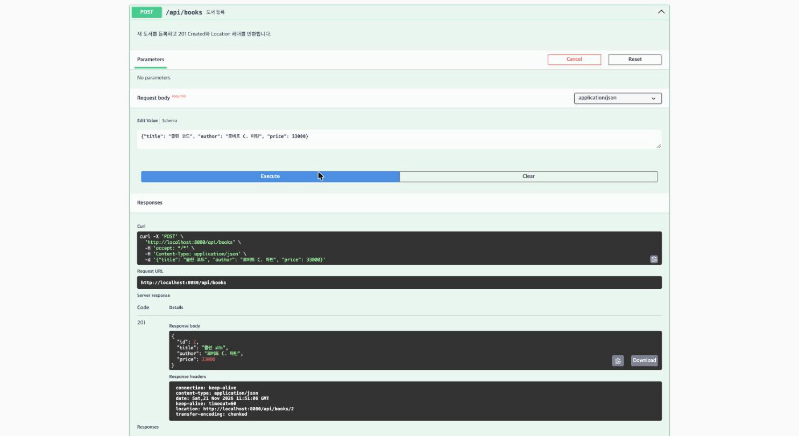
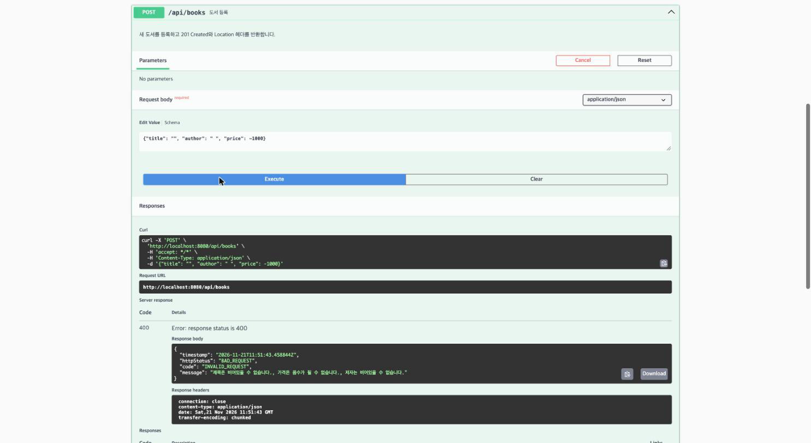
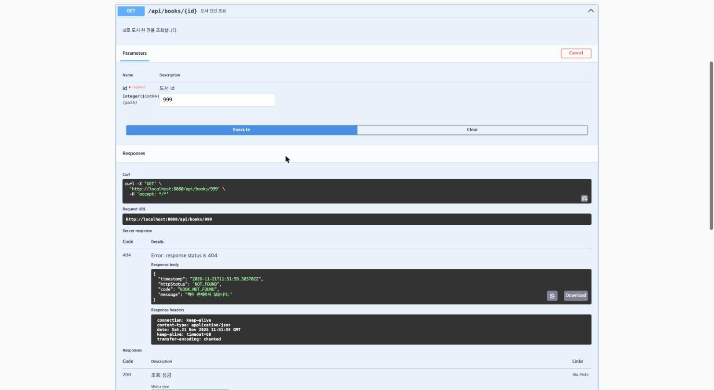
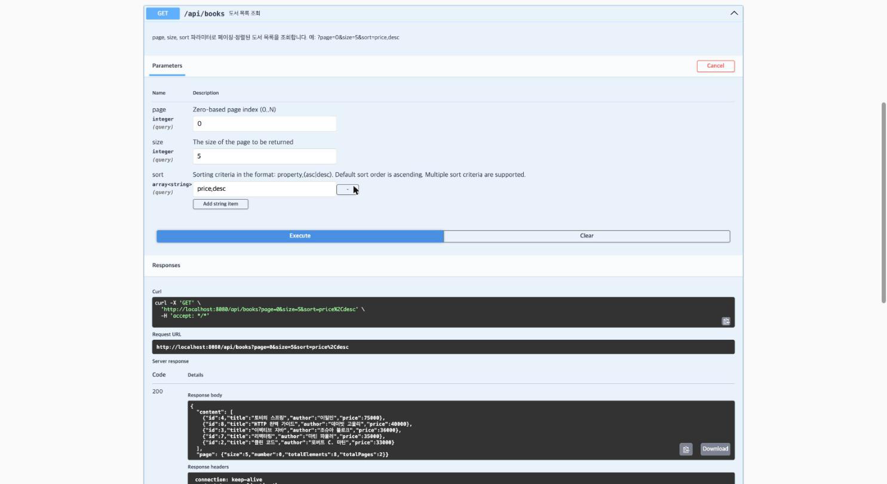
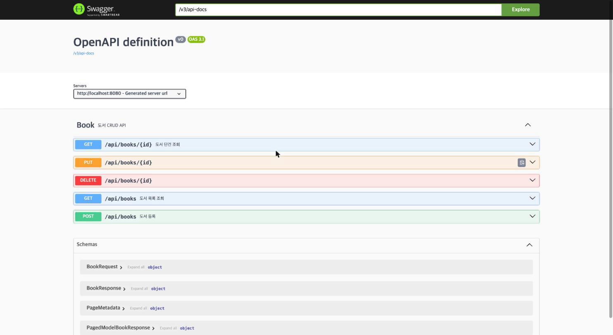
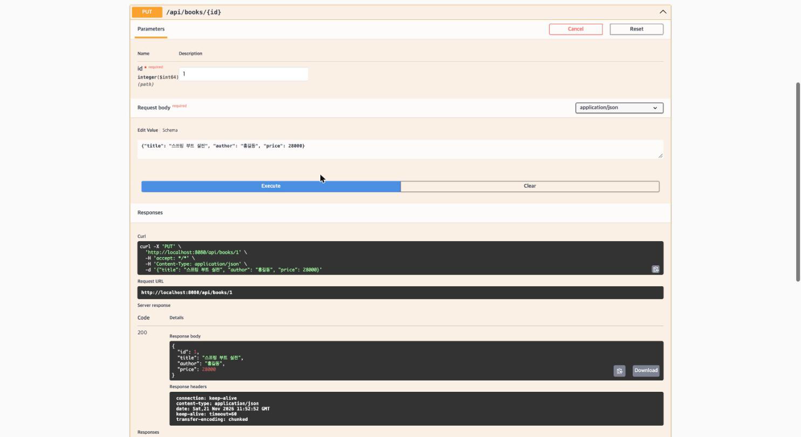
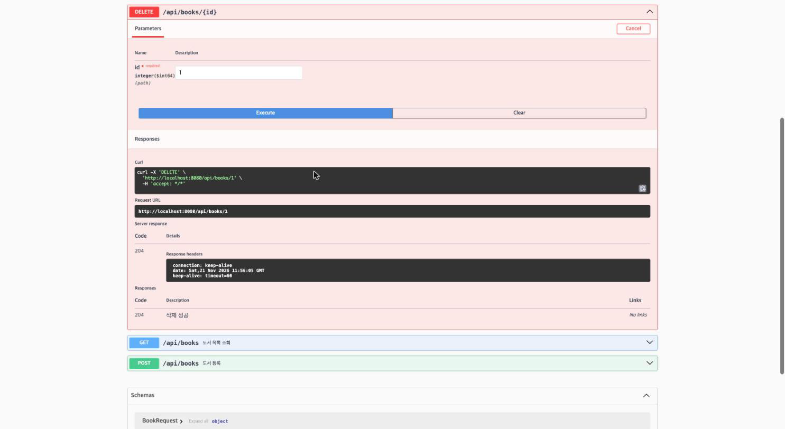
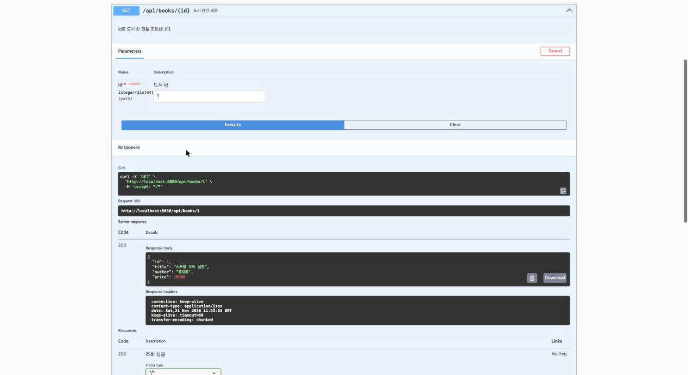

# Week 12 Sample Project - Book REST API (학생용 Starter)

## Project Information: 프로젝트 소개, GitHub URL, Render URL

도서(Book) 정보를 등록·조회·수정·삭제하는 Spring Boot REST API입니다. 기본 CRUD만 있던 Starter 프로젝트에 DTO 분리, `ResponseEntity`를 이용한 상태 코드 지정, Bean Validation, 전역 예외 처리, 페이징·정렬, Swagger 문서화를 추가했습니다.

- GitHub URL(조직): https://github.com/2026-2-WebService/assign12-c01-22300378
- GitHub URL(개인): https://github.com/ggm77/week12_sample_project.git
- Render URL: https://week12-sample-project-wunk.onrender.com

## Installation: Java/DB 환경과 실행 방법

### 환경
- Java 17
- Spring Boot 3.5.7, Gradle (Wrapper 포함)
- DB: MariaDB
- 주요 의존성: Spring Web, Spring Data JPA, Validation, springdoc-openapi 2.8.13

### 실행 방법 (H2, 기본)
```bash
./gradlew bootRun
```
- API: http://localhost:8080/api/books
- Swagger UI: http://localhost:8080/swagger-ui.html
- OpenAPI JSON: http://localhost:8080/v3/api-docs

### 실행 방법 (MariaDB)
```bash
docker compose up -d   # localhost:3307에 MariaDB 실행

SPRING_PROFILES_ACTIVE=mariadb \
DB_URL=jdbc:mariadb://localhost:3307/week12 \
DB_USERNAME=week12 \
DB_PASSWORD=week12_local_only \
DDL_AUTO=update \
./gradlew bootRun
```
- `DDL_AUTO=update`는 테이블을 처음 만들 때만 사용하고, 이후에는 `validate`를 권장합니다.

## Source Code Exploration: 분석 질문 8개 답변, 주석 작성한 메서드 3개

### ① Source Code Analysis

#### Project Structure & JPA

**Q1. BookController, BookService, BookRepository의 역할과 요청 처리 흐름**

`BookController`는 `/api/books`로 들어오는 HTTP 요청을 받아 URL이나 메서드에 맞는 핸들러(`list()`, `get()`, `create()`, `update()`, `delete()`)로 연결하고 결과를 JSON으로 돌려주는 웹 계층입니다. `BookService`는 Entity와 DTO간 변환, 조회 실패 처리 같은 비즈니스 로직을 담당하고(`findAll()`, `findById()`, `create()` 등), `BookRepository`는 DB 접근만 담당합니다. 즉 요청은 `Client → BookController.create() → BookService.create() → BookRepository.save() → DB` 순서로 내려갔다가, 결과가 `BookResponse`로 변환되어 역순으로 응답됩니다.
- 관련 파일: `BookController.java`, `BookService.java`, `BookRepository.java`

**Q2. `JpaRepository<Book, Long>`만 선언해도 `findAll()`, `save()`를 쓸 수 있는 이유**

`JpaRepository`가 `CrudRepository`, `PagingAndSortingRepository` 등을 상속하고 있어서 `findAll()`, `findById()`, `save()`, `deleteById()` 같은 메서드가 인터페이스에 이미 정의되어 있습니다. Spring Data JPA가 애플리케이션 시작 시 이 인터페이스의 구현체를 자동으로 만들어 Bean으로 등록하기 때문에, 직접 구현 클래스를 작성하지 않아도 `BookService`에 주입받아 사용할 수 있습니다. 제네릭 `<Book, Long>`은 각각 다룰 Entity 타입과 `@Id` 필드의 타입을 알려주는 역할입니다.
- 관련 파일: `BookRepository.java`, `BookService.findAll()`, `BookService.create()`

#### DTO & HTTP Response

**Q3. Book Entity를 직접 요청·응답에 사용할 때의 문제**

Entity를 요청 바디로 직접 받으면 클라이언트가 `id`처럼 서버가 관리해야 할 필드까지 보낼 수 있어 의도치 않은 값이 저장될 수 있습니다. 응답으로 그대로 내보내면 DB 테이블 구조가 API 스펙에 그대로 노출되고, Entity에 필드를 추가·변경하는 순간 API 응답까지 함께 바뀌어 클라이언트가 깨질 수 있습니다. 또 연관관계가 생기면 지연 로딩·순환 참조로 JSON 직렬화 오류가 날 수 있고, 검증 어노테이션(`@NotBlank` 등)을 Entity에 붙이면 DB 매핑과 입력 검증 책임이 섞이게 됩니다.
- 관련 파일: `Book.java`

**Q4. Request DTO와 Response DTO를 분리하는 이유와 ResponseEntity가 필요한 상황**

`BookRequest`는 클라이언트가 보낼 수 있는 값과 검증 규칙만 갖고, `BookResponse`는 클라이언트에게 보여줄 값만 갖도록 분리하면 입력과 출력의 스펙을 각각 독립적으로 관리할 수 있습니다. 변환은 `BookResponse.of(Book)`와 `BookService.create()` 안의 `new Book(...)`처럼 서비스 계층에서 한 번만 일어나게 됩니다. `ResponseEntity`는 상태 코드나 헤더를 직접 정해야 할 때 필요한데, 예를 들어 생성 시 `201 Created` + `Location` 헤더, 삭제 시 `204 No Content`, 데이터가 없을 때 `404 Not Found`를 돌려주는 경우입니다.
- 관련 파일: `BookRequest.java`, `BookResponse.of()`, `BookController.create()`, `BookController.delete()`

#### Validation & Exception Handling

**Q5. `@Valid`, `@NotBlank`, `@Min`의 동작 시점**

`@Valid`는 `BookController.create()`/`update()`의 `@RequestBody BookRequest` 앞에 붙어 있어서, JSON이 `BookRequest`로 변환된 직후·컨트롤러 메서드가 실행되기 전에 검증을 실행하라고 지시합니다. 이때 `@NotBlank`는 `title`, `author`가 null이거나 공백만 있는지 검사하고, `@Min(0)`은 `price`가 0보다 작은지 검사합니다. 하나라도 실패하면 메서드 본문은 실행되지 않고 `MethodArgumentNotValidException`이 발생해 기본적으로 `400 Bad Request`가 응답됩니다.
- 관련 파일: `BookRequest.java`, `BookController.create()`, `BookController.update()`

**Q6. `@RestControllerAdvice`와 `@ExceptionHandler` 사용 시 예외 처리 흐름 변화**

적용 전에는 `BookService.findById()`의 `orElseThrow()`가 던지는 `NoSuchElementException`을 아무도 처리하지 않아서, 없는 id를 조회하면 Spring 기본 에러 응답(500)이 나갔습니다. 지금은 Service가 없는 id에 대해 `CustomException(ExceptionCode.BOOK_NOT_FOUND)`를 던지고(`delete()`는 `existsById()`로 먼저 확인), 이 예외가 컨트롤러 밖으로 나가면 `@RestControllerAdvice`가 붙은 `CustomizedResponseEntityExceptionHandler`의 `@ExceptionHandler(CustomException.class)` 메서드가 받아 `ExceptionCode`에 정의된 상태 코드(404)와 `ExceptionResponse` JSON(`timestamp`, `httpStatus`, `code`, `message`)으로 변환합니다. 이 클래스는 `ResponseEntityExceptionHandler`를 상속해서 `@Valid` 검증 실패(`handleMethodArgumentNotValid`), 잘못된 JSON(`handleHttpMessageNotReadable`), 경로 변수 타입 불일치(`handleTypeMismatch`)를 오버라이드해 400으로 응답하고, 존재하지 않는 정렬 필드는 `@ExceptionHandler(PropertyReferenceException.class)`로 400, 그 외 예상하지 못한 예외는 `@ExceptionHandler(Exception.class)`로 500을 응답합니다. 결과적으로 컨트롤러마다 try-catch를 쓸 필요 없이 모든 에러가 한 곳에서 같은 JSON 형식으로 처리됩니다.
- 관련 파일: `BookService.findById()`, `BookService.update()`, `BookService.delete()`, `CustomException.java`, `ExceptionCode.java`, `ExceptionResponse.java`, `CustomizedResponseEntityExceptionHandler.java`

#### Pagination & OpenAPI

**Q7. `Pageable`과 `Page<T>`의 역할, `sort=price,desc` 처리 방식**

`Pageable`은 "몇 번째 페이지를, 몇 개씩, 어떤 정렬로" 가져올지를 담은 요청 정보이고, 컨트롤러 파라미터로 선언하면 Spring이 쿼리 파라미터 `page`, `size`, `sort`를 읽어 자동으로 만들어 줍니다. `Page<T>`는 그 결과로, 실제 데이터 목록(`content`)과 함께 전체 개수(`totalElements`), 전체 페이지 수(`totalPages`) 등 페이지 메타정보를 담고 있습니다. `sort=price,desc`는 `Sort.by(Sort.Direction.DESC, "price")`로 해석되어 `repository.findAll(pageable)` 실행 시 SQL에 `ORDER BY price DESC`와 `LIMIT/OFFSET`이 붙습니다.
- 관련 파일: `BookController.list(Pageable)`, `BookService.findAll(Pageable)`, `BookRepository.findAll(Pageable)`

**Q8. `/v3/api-docs`와 `/swagger-ui.html`의 차이**

`/v3/api-docs`는 springdoc-openapi가 컨트롤러의 매핑·DTO·검증 어노테이션을 분석해서 만든 OpenAPI 명세를 JSON 데이터로 제공하는 엔드포인트로, 다른 도구가 읽기 위한 기계용 문서입니다. `/swagger-ui.html`은 그 JSON을 읽어 사람이 브라우저에서 보기 좋게 렌더링한 UI 화면으로, 각 API를 펼쳐 보고 "Try it out"으로 직접 요청을 보내볼 수 있습니다. 즉 `/v3/api-docs`가 원본 데이터이고 `/swagger-ui.html`은 그 데이터를 보여주는 뷰어입니다.
- 관련 파일: `build.gradle` (`springdoc-openapi-starter-webmvc-ui` 의존성), `BookController.java`

### ② 주석 작성한 메서드 3개

소스 코드에 줄 단위로 설명 주석을 작성했습니다.
- `BookController.create()`: `@RequestBody`로 JSON을 `BookRequest` DTO로 변환하고 `@Valid`로 검증하는 시점, Service를 거쳐 `BookResponse`를 받는 흐름, `ServletUriComponentsBuilder`로 `Location` 헤더를 만들어 `ResponseEntity`로 201을 응답하는 과정
- `BookService.findById()`: `repository.findById()`가 `Optional<Book>`을 반환하는 이유, `orElseThrow()`로 `CustomException(BOOK_NOT_FOUND)`를 던지고 전역 예외 핸들러가 404 JSON으로 바꾸는 흐름
- `BookService.findAll(Pageable)`: `page`, `size`, `sort` 파라미터가 `Pageable`이 되어 `ORDER BY`·`LIMIT/OFFSET` 쿼리로 실행되는 과정, `Page.map()`으로 페이지 정보를 유지한 채 `BookResponse`로 변환

## Refactoring: DTO와 ResponseEntity 변경 전/후

### 변경 전
Controller와 Service가 `Book` Entity를 그대로 받고 그대로 돌려주었고, 상태 코드는 모두 200이었습니다.
```java
@PostMapping
public Book create(@RequestBody Book input) {
    return service.create(input);
}

@DeleteMapping("/{id}")
public void delete(@PathVariable Long id) {
    service.delete(id);
}
```

### 변경 후
요청은 `BookRequest`, 응답은 `BookResponse`로 분리하고, `ResponseEntity`로 상황에 맞는 상태 코드를 지정했습니다.
```java
public record BookRequest(
        @NotBlank(message = "제목은 비어있을 수 없습니다.") String title,
        @NotBlank(message = "저자는 비어있을 수 없습니다.") String author,
        @Min(value = 0, message = "가격은 음수가 될 수 없습니다.") int price
) {}

public record BookResponse(Long id, String title, String author, int price) {
    public static BookResponse of(Book book) { ... }
}
```
```java
@PostMapping
public ResponseEntity<BookResponse> create(@Valid @RequestBody BookRequest input) {
    final BookResponse bookResponse = service.create(input);
    return ResponseEntity.created(
            ServletUriComponentsBuilder.fromCurrentRequest()
                    .path("/{id}")
                    .buildAndExpand(bookResponse.id())
                    .toUri()
    ).body(bookResponse);
}

@DeleteMapping("/{id}")
public ResponseEntity<Void> delete(@PathVariable Long id) {
    service.delete(id);
    return ResponseEntity.noContent().build();
}
```

### 변경 전/후 API 요청·응답 차이
Starter 코드(첫 커밋)와 현재 코드를 각각 실행해서 같은 요청을 보낸 결과입니다.

- `POST /api/books` (정상 입력): `200 OK`에 `Location` 헤더 없음 → `201 Created`와 `Location: /api/books/1`
- `POST /api/books` (`title: ""`, `price: -1000`): `200 OK`로 잘못된 값이 그대로 저장됨 → `400 Bad Request` (`INVALID_REQUEST`)
- `GET /api/books/999` (없는 id): `500 Internal Server Error` → `404 Not Found` (`BOOK_NOT_FOUND`)
- `PUT /api/books/999` (없는 id): `500 Internal Server Error` → `404 Not Found` (`BOOK_NOT_FOUND`)
- `DELETE /api/books/1`: `200 OK`에 빈 바디 → `204 No Content`
- `DELETE /api/books/999` (없는 id): `200 OK`로 삭제된 것처럼 보임 → `404 Not Found` (`BOOK_NOT_FOUND`)
- `GET /api/books?page=0&size=1&sort=price,desc`: 파라미터를 무시하고 전체 목록을 JSON 배열로 반환 → `content`와 `page` 메타데이터를 담은 페이지 응답

**POST 정상 입력**
```http
### 변경 전
HTTP/1.1 200
Content-Type: application/json

{"id":1,"title":"Clean Code","author":"Martin","price":35000}

### 변경 후
HTTP/1.1 201
Location: http://localhost:8080/api/books/1
Content-Type: application/json

{"id":1,"title":"Clean Code","author":"Martin","price":35000}
```

**POST 잘못된 입력** (`{"title":"","author":"Martin","price":-1000}`)
```http
### 변경 전: 검증 없이 저장
HTTP/1.1 200

{"id":2,"title":"","author":"Martin","price":-1000}

### 변경 후
HTTP/1.1 400

{"timestamp":"2026-11-21T12:56:30.778903Z","httpStatus":"BAD_REQUEST","code":"INVALID_REQUEST","message":"제목은 비어있을 수 없습니다., 가격은 음수가 될 수 없습니다."}
```

**없는 id 조회** (`GET /api/books/999`)
```http
### 변경 전: NoSuchElementException을 처리하지 않아 Spring 기본 에러 응답
HTTP/1.1 500

{"timestamp":"2026-11-21T12:56:30.676+00:00","status":500,"error":"Internal Server Error","path":"/api/books/999"}

### 변경 후
HTTP/1.1 404

{"timestamp":"2026-11-21T12:56:30.794727Z","httpStatus":"NOT_FOUND","code":"BOOK_NOT_FOUND","message":"책이 존재하지 않습니다."}
```

**목록 조회** (`GET /api/books?page=0&size=1&sort=price,desc`)
```http
### 변경 전: size=1이어도 전체가 배열로 반환
HTTP/1.1 200

[{"id":1,"title":"Clean Code","author":"Martin","price":35000},{"id":2,"title":"","author":"Martin","price":-1000}]

### 변경 후
HTTP/1.1 200

{"content":[{"id":1,"title":"Clean Code","author":"Martin","price":35000}],"page":{"size":1,"number":0,"totalElements":1,"totalPages":1}}
```

## New Features: Validation, 공통 예외 처리, Pagination/Sorting, Swagger

### 1. Validation
`BookRequest`에 `@NotBlank`(title, author)와 `@Min(0)`(price)을 붙이고, Controller의 `create()`·`update()`에서 `@Valid`로 검증합니다. 검증에 실패하면 각 필드의 메시지를 합쳐 400으로 응답합니다.

### 2. 공통 예외 처리
`exception` 패키지에 공통 예외 구조를 만들었습니다.
- `ExceptionCode`: 에러 코드, HTTP 상태, 메시지를 모아 둔 enum (`INVALID_REQUEST`, `INVALID_JSON`, `INVALID_PARAMETER`, `BOOK_NOT_FOUND`, `INTERNAL_SERVER_ERROR`)
- `CustomException`: `ExceptionCode`를 담아서 던지는 예외 (예: 없는 id → `BOOK_NOT_FOUND`)
- `ExceptionResponse`: 에러 응답 JSON (`timestamp`, `httpStatus`, `code`, `message`)
- `CustomizedResponseEntityExceptionHandler`: `@RestControllerAdvice`로 모든 예외를 받아 `ExceptionResponse`로 변환

```json
{
  "timestamp": "2026-11-21T11:51:59.303702Z",
  "httpStatus": "NOT_FOUND",
  "code": "BOOK_NOT_FOUND",
  "message": "책이 존재하지 않습니다."
}
```

### 3. Pagination / Sorting
`GET /api/books`가 `Pageable`을 받아 `Page<BookResponse>`를 반환합니다. 파라미터가 없으면 `@PageableDefault`에 따라 10개씩 id 순으로 조회합니다. `@EnableSpringDataWebSupport(pageSerializationMode = VIA_DTO)`를 설정해서 응답이 `content`와 `page` 메타데이터로 일정하게 나옵니다.
```json
{
  "content": [ { "id": 4, "title": "토비의 스프링", "author": "이일민", "price": 75000 }, ... ],
  "page": { "size": 5, "number": 0, "totalElements": 8, "totalPages": 2 }
}
```

### 4. Swagger
`springdoc-openapi-starter-webmvc-ui`를 추가해서 `/swagger-ui.html`과 `/v3/api-docs`를 활성화했습니다. Controller에 `@Tag`를 달고, 목록 조회·단건 조회·등록에 `@Operation`을, 단건 조회·등록·삭제에 `@ApiResponse`를 추가했습니다. `Pageable`에는 `@ParameterObject`를 붙여 Swagger에서 `page`, `size`, `sort`를 따로 입력할 수 있게 했습니다.

## Testing & Deployment: results/ 스크린샷 6장 이상 및 배포 URL

### Local Testing

#### 01. 초기 Sample CRUD 테스트 (Customizing 전, Postman)
- POST `/api/books` → 200 OK, Entity 그대로 응답



- GET `/api/books` → 200 OK, 페이징 없이 배열로 응답



> 02번부터는 Customizing 후 Swagger UI에서 테스트한 화면입니다.

#### 02. DTO 적용 후 POST 성공 (201)


#### 03. 잘못된 입력 요청 (400)


#### 04. 존재하지 않는 ID (404)


#### 05. 페이지/정렬 적용 결과


#### 06. Swagger UI


#### 07. 수정 (PUT)


#### 08. 삭제 (DELETE, 204)


#### 09. 단건 조회 (GET, 200)


### Deployment
- GitHub URL(조직): https://github.com/2026-2-WebService/assign12-c01-22300378
- GitHub URL(개인): https://github.com/ggm77/week12_sample_project.git
- Render URL: https://week12-sample-project-wunk.onrender.com

## Weekly Review: 새롭게 배운 내용 3가지, 어려웠던 점과 해결 방법, AI 활용 내용 및 느낀 점

### 새롭게 배운 내용 3가지
1. **Entity와 DTO 분리:** Entity를 그대로 주고받으면 id 같은 값까지 클라이언트가 바꿀 수 있고 DB 구조가 API에 묶인다는 것을 알게 되었습니다. `BookRequest`, `BookResponse`로 나누니 입력과 출력의 규칙을 따로 관리할 수 있었습니다.
2. **`ResponseEntity`로 상태 코드 지정:** 생성은 201과 `Location` 헤더, 삭제는 204처럼 상황에 맞는 상태 코드를 돌려줘야 클라이언트가 결과를 정확히 알 수 있다는 것을 배웠습니다.
3. **`@RestControllerAdvice`로 예외 처리 통일:** 예외를 한 곳에서 처리하니 400, 404, 500 응답이 모두 같은 JSON 형식으로 나가고, 컨트롤러 코드에는 try-catch가 필요 없었습니다.

### 어려웠던 점과 해결 방법
- **Validation 에러만 형식이 달랐던 문제:** `@Valid` 검증 실패는 부모 클래스 `ResponseEntityExceptionHandler`가 먼저 처리해서 Spring 기본 형식으로 응답되었습니다. `handleMethodArgumentNotValid`를 오버라이드해서 다른 에러와 같은 `ExceptionResponse` 형식으로 맞췄습니다.
- **없는 id 삭제 시 404가 안 나오던 문제:** `deleteById()`는 없는 id여도 예외 없이 지나가서 항상 성공처럼 보였습니다. `existsById()`로 먼저 확인하고 없으면 `BOOK_NOT_FOUND`를 던지도록 바꿨습니다.
- **Page 응답 형식 경고:** `Page`를 그대로 반환하면 Spring Data가 경고를 띄우고 응답 구조도 버전마다 달라질 수 있었습니다. `@EnableSpringDataWebSupport(pageSerializationMode = VIA_DTO)`를 설정해서 해결했습니다.

### AI 활용 내용 및 느낀 점
Claude Code를 사용해서 코드 분석, 일부 이상했던 부분들에 대해 질문을 했습니다. 
직접 코드를 작성하고 AI에게 검사를 받는게 배울때는 효율적이다고 느꼈습니다.